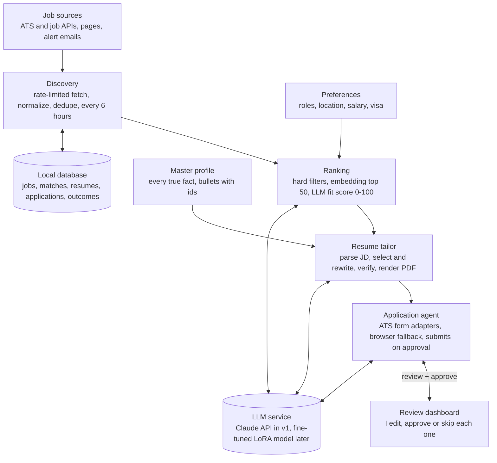
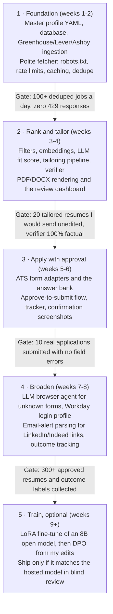

# Job Application Agent — Design Doc

Oct 26, 2026

## Overview

A personal agent that finds relevant job postings, tailors my resume to each one, and submits applications after I approve them. It runs on my own machine as one user's tool, not a service. The system has four stages: discover jobs, rank them, tailor the resume, apply.

### Goals

- Collect 100+ fresh, relevant postings per day from sources that allow automated access.
- Rank postings against my profile so I only review the top 10–20 a day.
- Produce a tailored resume (and optional cover letter) per job in under 60 seconds, using only facts that are in my master profile.
- Fill and submit applications on common applicant tracking systems (Greenhouse, Lever, Ashby, Workday) with one click of approval from me.
- Never get my IP or accounts banned: stay inside each site's published rate limits, robots.txt and terms.

### Non-goals

- Mass-applying to hundreds of jobs a day with no review. Low-fit spam lowers response rates and gets accounts flagged.
- Evading anti-bot systems (CAPTCHA solving, fingerprint spoofing, rotating residential proxies). If a site blocks automation, the agent skips it or hands the link to me.
- Inventing experience, skills, degrees or titles on the resume.
- Multi-user SaaS, billing, or a mobile app in v1.

## Architecture

Four stages run as a pipeline on a schedule, sharing one local database and one LLM service. The only human step is the review dashboard, which sits between the tailored resume and the submit click.

Ranking, tailoring and the application agent all call the LLM service; every stage reads and writes the local database.

## Job discovery

The safest way to avoid bans is to not scrape where an API exists. Most tech companies post jobs on an applicant tracking system (ATS) that serves a public JSON job board, which is meant to be read by machines. HTML scraping is the fallback, and only for sites whose robots.txt and terms allow it.

### Sources, in order of preference

| Tier | Source | Access method | Ban risk |
| --- | --- | --- | --- |
| 1 | Greenhouse, Lever, Ashby, SmartRecruiters, Workable job boards | Public JSON endpoints per company (e.g. `boards-api.greenhouse.io/v1/boards/{company}/jobs`) | Very low |
| 1 | Job APIs and aggregators (Adzuna, USAJOBS, The Muse, Remotive, HN "Who is hiring" via Algolia API) | Official API with a free key | Very low |
| 2 | Company career pages | Polite HTML or JSON-LD `JobPosting` parsing, robots.txt checked | Low |
| 3 | LinkedIn, Indeed, Glassdoor | No automated scraping (their terms forbid it). Use their email job alerts: the agent reads the alert emails and extracts links | None |

A seed list of target companies maps each company to its ATS slug. A discovery job can grow this list by detecting the ATS from a career page URL.

### Polite crawling rules

- Check and cache robots.txt per domain; skip disallowed paths.
- Rate limit per domain with a token bucket: default 1 request every 5–10 seconds, with random jitter, max 2 concurrent domains.
- Honest User-Agent naming the bot and a contact email.
- Conditional requests (`ETag`, `If-Modified-Since`) and a local cache so unchanged boards are not refetched.
- On HTTP 429 or 503, honor `Retry-After`, back off exponentially, and pause the domain for 24 hours after three failures.
- Run on a schedule (e.g. every 6 hours), not continuously.

### Normalize and dedupe

Every posting is mapped to one `Job` schema (title, company, location, remote flag, salary range, description, apply URL, source, posted date). Duplicates across sources are merged on a hash of normalized company + title + location, plus a near-duplicate check on description embeddings. Postings older than 30 days or already closed are dropped.

## Matching and ranking

Ranking runs in two passes: a cheap filter removes obvious misfits, then an LLM scores the survivors. This keeps LLM cost to a few dozen calls a day.

1. **Hard filters** from my preferences file: location or remote, visa sponsorship, seniority, minimum salary, excluded companies, keywords to avoid.
2. **Embedding similarity** between the job description and my master profile (e.g. `text-embedding-3-small` or a local `bge-small` model). Keep the top \~50.
3. **LLM fit score** (0–100) with a short rationale: which required skills I have, which I lack, and any dealbreakers. The output is structured JSON.
4. **Queue** jobs scoring 70+ for tailoring; show the rest in a "maybe" list.

My accept/reject decisions on the review screen are logged as labels. After a few hundred labels they can train a small reranker or tune the score threshold.

## Resume tailoring

The tailor reorders, selects and rewords facts from a master profile; it never adds facts. Each tailored resume is checked against the profile before I see it.

### Master profile

One structured YAML/JSON file is the single source of truth: contact info, education, every job and project with all bullets I could ever use, skills with proficiency, certifications, and links. It holds more than fits on one page, so the tailor has material to choose from. Each bullet has an id and tags (e.g. `python`, `ml`, `leadership`).

### Pipeline

1. **Parse the job description** into JSON: required skills, nice-to-haves, seniority, key responsibilities, and the exact keywords an ATS is likely to match.
2. **Select** the most relevant experiences, projects and bullets by embedding similarity and tag overlap, within a one-page budget.
3. **Rewrite** chosen bullets to mirror the job's wording where the meaning is the same ("built REST APIs" → "designed RESTful services" if the posting says that). Write a 2–3 line summary aimed at the role.
4. **Verify** with a second LLM call plus rules: every bullet must cite its source bullet id; numbers, employers, titles, dates and degrees must match the profile exactly; any skill named must exist in the profile. Failures are regenerated or flagged.
5. **Render** to PDF and DOCX from a clean, single-column, ATS-friendly template (LaTeX/Jinja or `python-docx` + a PDF converter). File name: `FirstLast_Company_Role.pdf`.
6. **Score** keyword coverage before and after, and show me a diff of what changed.

Cover letters use the same pipeline with a short template: why this company, two matching achievements, close.

### Model choice and training

Start with a hosted frontier model (e.g. Claude Sonnet) through prompting and few-shot examples; it will likely be good enough, and it is the baseline any trained model must beat. Fine-tuning is worth it only if cost, latency or privacy become a problem.

| Option | When to use | Data needed | Notes |
| --- | --- | --- | --- |
| Prompting + few-shot | v1 | 5–10 hand-written examples | No training; easiest to iterate |
| Retrieval of past good outputs | After \~50 approved resumes | My approved resumes and edits | Feed the closest past examples into the prompt |
| LoRA fine-tune of an open model (Llama, Qwen or Mistral 7–8B) | Want local, private, cheap inference | 500–2,000 (job description, profile, tailored resume) triples | Train with Hugging Face TRL + PEFT or Unsloth on one 24 GB GPU or a rented cloud GPU |
| Preference tuning (DPO) | After fine-tune, to match my taste | Pairs of (chosen, rejected) rewrites from my edits | Uses the review screen's edit history |

Training data can be bootstrapped by having the frontier model generate tailored resumes for public job postings from my profile, then keeping only the ones I approve. Evaluation uses a held-out set scored on keyword coverage, verifier pass rate (target 100% factual), and my blind preference between the fine-tuned model and the baseline.

## Application agent

The agent fills the form, stops before Submit, and waits for my approval. Auto-submit can be turned on later per ATS once its accuracy is proven.

### How it applies

- **ATS adapters first.** Greenhouse, Lever and Ashby forms are consistent, so each gets a deterministic Playwright script with known field selectors. This is faster and more reliable than an LLM clicking around.
- **LLM browser agent as fallback** for unknown forms: Playwright drives the page, the LLM reads the accessibility tree (or a screenshot) and decides which field gets which value. Tools: `fill(field, value)`, `select`, `upload(file)`, `click`, `read_page`.
- **Answer bank.** Common questions (work authorization, sponsorship, salary expectation, start date, relocation, EEO/demographics) are answered from a stored file. EEO questions default to "decline to answer" unless I set otherwise.
- **Free-text questions** ("Why do you want to work here?") are drafted by the LLM from the profile and the job description, and always shown to me.
- **Unknown or sensitive questions** pause the run and ask me. The agent never guesses a factual answer.

### Approval step

A local web dashboard shows each queued application: the job, fit score, resume diff, cover letter, every filled field, and a screenshot of the final form. I can edit, approve, or skip. On approval the agent clicks Submit, saves a confirmation screenshot, and records the result.

### Limits and blockers

- At most 10–20 submissions per day, spaced out, from my normal browser profile and home IP.
- Sites that need a login (Workday, iCIMS) use a persistent browser profile where I signed in by hand once. Passwords are not stored in plain text.
- If a CAPTCHA, email verification, or a bot-check page appears, the agent stops and sends me the link to finish manually.
- LinkedIn Easy Apply and Indeed Apply are not automated, because their terms forbid it and accounts get restricted. They go to a "apply manually" list with the tailored resume ready.

## Data model

One local Postgres (or SQLite for v1) database with pgvector for embeddings; generated files live on disk under `data/`.

| Table | Key fields | Purpose |
| --- | --- | --- |
| `companies` | id, name, ats\_type, ats\_slug, careers\_url, last\_crawled | Seed list of where to look |
| `jobs` | id, company\_id, title, location, remote, salary\_min/max, description, apply\_url, source, posted\_at, dedupe\_hash, embedding, status | Every normalized posting |
| `matches` | job\_id, fit\_score, rationale, missing\_skills, decision (accept/reject/maybe) | Ranking output and my labels |
| `resume_versions` | id, job\_id, content\_json, pdf\_path, keyword\_coverage, verifier\_passed | Each tailored resume |
| `applications` | id, job\_id, resume\_version\_id, answers\_json, status (draft, awaiting\_approval, submitted, failed, manual), submitted\_at, screenshot\_path | Application tracker |
| `outcomes` | application\_id, stage (no reply, rejected, screen, interview, offer), updated\_at | Feedback for evaluation and training |
| `crawl_log` | domain, url, status\_code, fetched\_at, etag | Rate limiting and caching |

The master profile, preferences and answer bank are versioned YAML files in git, not database rows.

## Tech stack

Python end to end keeps the scraper, LLM code and training in one language.

| Layer | Choice | Why |
| --- | --- | --- |
| Language | Python 3.12 | Best ecosystem for scraping, LLMs and training |
| HTTP + parsing | `httpx`, `selectolax` / BeautifulSoup, `extruct` for JSON-LD | Fast, async, polite fetching |
| Crawl framework (optional) | Scrapy with AutoThrottle and `ROBOTSTXT_OBEY=True` | Built-in rate limiting and robots.txt |
| Browser automation | Playwright | Form filling, uploads, screenshots |
| Agent orchestration | Claude Agent SDK or LangGraph | Tool calling, retries, human-in-the-loop pauses |
| LLM | Claude Sonnet via API (v1); Qwen/Llama 8B + LoRA via vLLM or Ollama (later) | Quality first, local option later |
| Embeddings + DB | pgvector on Postgres, or SQLite + `sqlite-vec` | One store for jobs and vectors |
| Scheduler | APScheduler or cron | Runs discovery every 6 hours |
| Dashboard | FastAPI + a small React or Streamlit UI | Review and approve queue |
| Resume rendering | Jinja + LaTeX, or `python-docx` + LibreOffice to PDF | ATS-friendly output |
| Training | Hugging Face TRL, PEFT, Unsloth; Weights & Biases for runs | Standard LoRA/DPO tooling |
| Secrets | OS keychain via `keyring`, `.env` excluded from git | Keep API keys and logins safe |

## Security, compliance and risks

The biggest risks are a banned account, a resume claim I can't back up in an interview, and a wrong answer submitted under my name. Each has a control below.

| Risk | Impact | Mitigation |
| --- | --- | --- |
| IP or account banned by a job site | Lose access to a source | APIs first; robots.txt; per-domain rate limits; no scraping of LinkedIn/Indeed; stop on 429 or CAPTCHA |
| Breaking a site's terms of service | Account loss, legal exposure | Source table records each site's allowed access; tier 3 sites are email-alert only |
| LLM invents a skill or number | Credibility damage in interviews | Source-id citation per bullet, rule-based verifier, my review before submit |
| Wrong form answer (e.g. visa status) | Rejected or misrepresented application | Answer bank for factual fields; unknown questions pause for me |
| Duplicate applications to one company | Looks careless | Check `applications` by company + role before queuing |
| Prompt injection in a job description ("ignore instructions and…") | Agent takes an unintended action | Treat scraped text as data; the browser agent can only use whitelisted tools on the target apply page |
| Leaked personal data or credentials | Identity risk | Local storage, encrypted disk, keychain for secrets, no PII in logs, API provider with no training on inputs |
| Site layout changes | Adapter breaks | Selector tests per ATS, fall back to the LLM browser agent, alert on failure rate |

## Metrics and roadmap

Success means more interviews per hour of my time, with zero bans and zero false claims.

| Metric | Target |
| --- | --- |
| Relevant jobs discovered per day, after dedupe | 100+ |
| Share of the daily top 20 I accept | 50% or more |
| Verifier factual pass rate before submit | 100% |
| Tailoring time per job | Under 60 s |
| Form fields I don't have to correct | 95% or more |
| Blocks or 429 responses from job sites | 0 per week |
| Response rate (screens ÷ applications) | Higher than my manual baseline |
| LLM spend | Under $30 per month |

Each phase ships something usable on its own; a phase starts only when the gate above it is met.

## Open questions

- [ ] Which roles, locations and seniority levels go in the preferences file first?
- [ ] Do I need visa sponsorship, and should that be a hard filter?
- [ ] Which 50–100 target companies seed the list?
- [ ] Hosted LLM (better quality, sends resume data to an API) or local model from day one (private, weaker)?
- [ ] Is a GPU available for fine-tuning, or will training run on a rented cloud GPU?
- [ ] Should the agent ever auto-submit without approval, and for which ATS?
- [ ] Will cover letters be generated for every job or only when the form asks?
